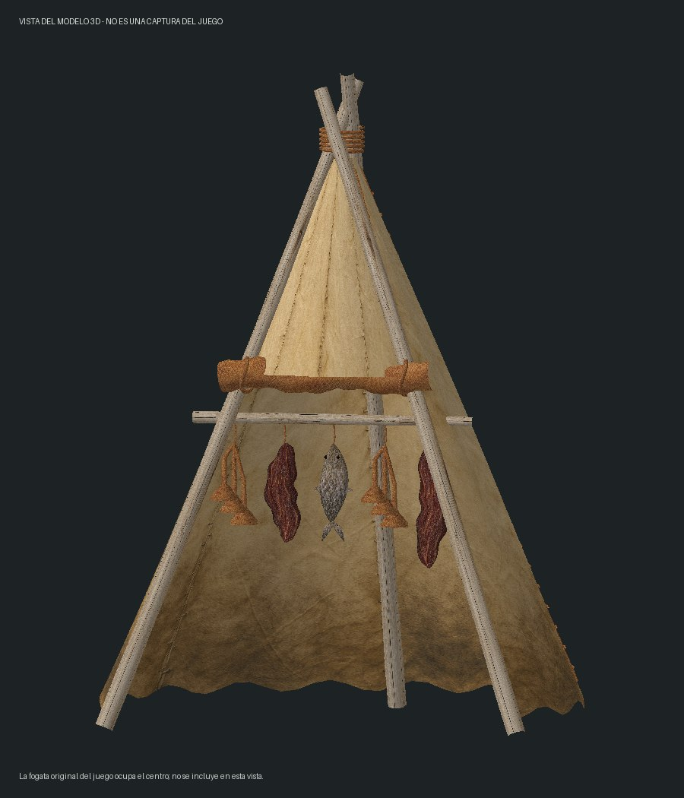

# Burebista Portable Smoker v0.2.4 — Español / English

[Descargar / Download](https://github.com/florynstefanache-source/BurebistaPortableSmoker/releases/latest) · [English](#english)

Vista del modelo 3D del mod; no es una captura dentro del juego. La fogata del juego no aparece en esta vista. / Preview of the mod's 3D model, not an in-game screenshot. The native campfire is not shown in this preview.

## Español

Traducción del ahumador: objeto y receta, panel, controles, avisos de carga y recogida, desplegar y empaquetar. Los alimentos ahumados conservan sus nombres traducidos. Los textos siguen Español o English en el juego.

La v0.2.4 corrige la recogida con Ctrl + F10. El ahumador solo se retira después de confirmar su entrega en la mochila. Burebista ha probado esta corrección en su partida.

### Instalar

Cierra el juego y copia **todo el contenido de Mods de este ZIP** a TheLongDark/Mods, sustituyendo los archivos anteriores. Se incluyen el ahumador, su .modcomponent y sus complementos de ahumado, modelo, icono y prueba. Guarda copias antiguas fuera de Mods; conserva tus configuraciones y partida.

Requiere MelonLoader, ModComponent (con sus dependencias) y ModData. No necesita BurebistaLanguages.dll. Actualiza todos los archivos incluidos, no solo el DLL principal.

### Receta y uso

12 palos + 3 pieles curadas de ciervo + 4 tripas curadas + 2 telas + 10 piedras. Cuchillo, luz y 8 horas; no requiere banco.

- F7: desplegar el ahumador de la mochila.
- Enciende y alimenta la fogata con los controles normales del juego.
- + cerca del ahumador: abrir/cerrar panel.
- Flechas izquierda/derecha: elegir alimento de la mochila.
- Enter: cargar pieza o pila completa; máximo cinco cargas.
- F9: recoger alimentos listos.
- Retroceso: devolver todas las cargas, incluidas las que no están terminadas.
- Ctrl + F10: empaquetar, con la fogata apagada.

Carne/pescado: 4 horas de fuego. Setas: 2 horas de fuego. Sin fuego, se pausa el progreso. El ahumado ralentiza el deterioro y conserva las demás propiedades del alimento; no inventa nuevos bonus alimentarios.

El complemento opcional de prueba conserva Ctrl + Mayús + F8 para entregar un ahumador. No es necesario para fabricarlo.

## English

Smoker localization: item and recipe description, smoking panel, controls, loading/collection notices, deployment and packing. Smoked food names are localized too. Text follows Spanish or English selected in the game.

Version 0.2.4 fixes packing with Ctrl + F10. The deployed smoker is removed only after inventory delivery is confirmed. Burebista tested this fix in their save.

### Installation

Close the game and copy **everything inside the ZIP Mods folder** into TheLongDark/Mods, replacing previous files. Includes the smoker, its .modcomponent and smoking, model, icon and test addons. Keep backups outside Mods; preserve configuration and saves.

Requires MelonLoader, ModComponent with its dependencies, and ModData. BurebistaLanguages.dll is not required. Update all included files, not only the main DLL.

### Crafting and controls

12 sticks + 3 cured deer hides + 4 cured guts + 2 cloth + 10 stones. Requires a knife, light and 8 hours; no workbench.

- F7: deploy the smoker from inventory.
- Light and fuel its campfire using normal game controls.
- + near the smoker: open/close panel.
- Left/right arrows: select food in your backpack.
- Enter: load the full piece or stack; maximum five batches.
- F9: collect ready food.
- Backspace: return all batches, including unfinished ones.
- Ctrl + F10: pack up with the fire extinguished.

Meat/fish requires 4 hours of fire; mushrooms 2 hours. Progress pauses without fire. Smoking slows spoilage while retaining the food's other properties.

The optional test addon retains Ctrl + Shift + F8 to grant a smoker. It is not needed for crafting.

## Verificación / Validation

Compilación sin errores, 68 comprobaciones de idioma superadas y conservación de receta, complementos y código de guardado verificada. Burebista ha confirmado que esta versión funciona en su partida.

Build completed without errors; 68 language checks passed, with recipe, addons and save-code preservation verified. Burebista confirmed this version working in their game.

## Créditos / Credits

Mod de Burebista. The Long Dark pertenece a Hinterland Studio. Mod de aficionados no oficial. / Mod by Burebista. The Long Dark belongs to Hinterland Studio. Unofficial fan mod.